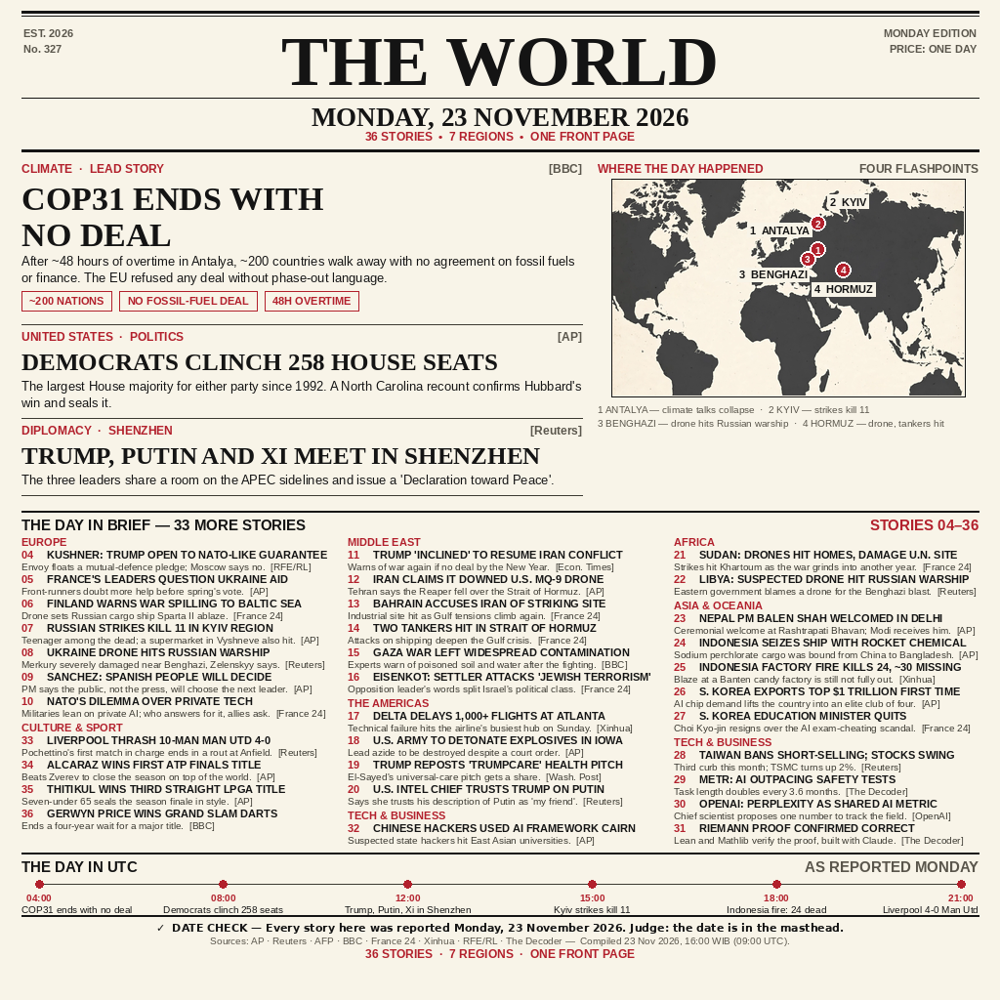

# The World — Monday, 23 November 2026

One image that sums up the world's news of Monday, 23 November 2026 — a dense newspaper front page: **36 stories, 7 regions, one front page and a map**.

## The day's news

- **COP31 ends with no deal** — after ~48 hours of overtime in Antalya, ~200 countries walk away with no agreement on fossil fuels or finance; the EU refused any deal without phase-out language.
- **Democrats clinch 258 House seats** — the largest House majority for either party since 1992; a North Carolina recount confirms Hubbard's win and seals it.
- **Trump, Putin and Xi meet in Shenzhen** — the three leaders share a room on the APEC sidelines and issue a "Declaration toward Peace".
- **Plus 33 more stories** across Europe, the Middle East, the Americas, Africa, Asia & Oceania, Tech & Business, and Culture & Sport — with a world map marking the four flashpoints, a UTC timeline, sourcing tags, and a date check.

## How it works

`entry.png` is the image (1024×1024, under 1 MiB). `main.ts` (Node 22, standard library only) checks it against the gate's limits and copies it to `/output/entry.png`, where the judge reads it. `render.py` is the Pillow script that drew the front page in this session from the flat world-map base (`world-map-base.png`) — every headline is real text, so the page stays legible at full size. Re-running it reproduces the same image.

Built for the [make.fun](https://make.fun) news-image-20261123 bounty.

## License

MIT
